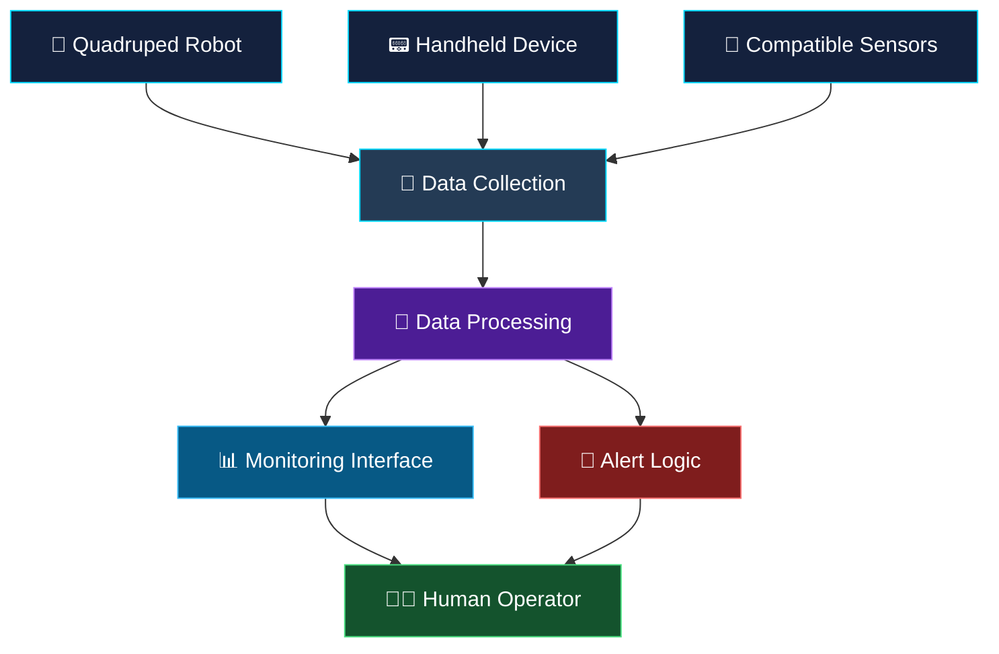

<!--
  DETECTX 2.0 | GitHub README
  Replace YOUR_GITHUB_USERNAME and YOUR_REPOSITORY_NAME
  with your actual GitHub details.
-->

<div align="center">


### 🚆 AI-POWERED RAILWAY SECURITY & INTELLIGENT MONITORING

**An innovative railway safety concept combining intelligent robotics, sensor technologies, and real-time monitoring.**

<p>
  
  
  
  
</p>

🌐 **Project Website:** [Explore DETECTX 2.0](https://preview-react-9bk1ae-dky4jd9a8qjsnkqogmdzak.onspace.build/?_q=Dky4jD9a8qjsNKqoGmDZaK)

</div>

---

## 📌 Table of Contents

- [🌟 About the Project](#-about-the-project)
- [🎯 Problem Statement](#-problem-statement)
- [💡 Our Proposed Solution](#-our-proposed-solution)
- [⚙️ Key Features](#️-key-features)
- [🏗️ System Architecture](#️-system-architecture)
- [🔄 Project Workflow](#-project-workflow)
- [🤖 Robotics and Intelligent Monitoring](#-robotics-and-intelligent-monitoring)
- [🧰 Technology Stack](#-technology-stack)
- [🖥️ Website Overview](#️-website-overview)
- [🚀 Getting Started](#-getting-started)
- [🗺️ Future Roadmap](#️-future-roadmap)
- [👨‍💻 Project Information](#-project-information)
- [🤝 Contributions](#-contributions)
- [📜 Disclaimer](#-disclaimer)

---

## 🌟 About the Project

**DETECTX 2.0** is an innovative railway security and monitoring concept designed to explore how artificial intelligence, robotics, intelligent sensors, and connected monitoring systems can contribute to safer railway environments.

The concept brings together a mobile quadruped robot, a handheld detection device, and an intelligent monitoring workflow to support the identification of potential safety concerns.

The project aims to explore a modern, technology-driven approach to railway security, situational awareness, and early warnings.

Our vision is to combine intelligent hardware with software-based analysis to support railway personnel in making informed decisions.

> 🚄 **Our Vision:** Build smarter railway monitoring solutions through robotics, intelligent sensing, and responsible AI integration.

### ✨ What makes DETECTX 2.0 interesting?

- 🤖 Robotics-assisted inspection concepts.
- 🧠 AI-assisted analysis and decision support.
- 📡 Intelligent sensor integration.
- 📊 Centralized monitoring and visualization.
- 🚨 Potential threat identification and early-warning workflows.
- 🔗 Integration possibilities between mobile devices, sensors, and monitoring software.

---

## 🎯 Problem Statement

Railway environments are complex, dynamic spaces where effective monitoring and timely identification of potential safety concerns are important.

Traditional monitoring approaches can face challenges involving coverage, response time, manual inspection, and the integration of information from multiple sources.

DETECTX 2.0 explores a technology-assisted approach that could help address these challenges through:

- Limited visibility in certain inspection areas.
- The need for more flexible inspection and monitoring methods.
- Difficulty combining information from multiple sensors.
- The importance of identifying potential risks at an early stage.
- The need for clear monitoring interfaces and actionable alerts.

**Goal:** Explore an integrated railway monitoring concept that supports human operators with intelligent technology.

---

## 💡 Our Proposed Solution

DETECTX 2.0 is built around three conceptual components.

### 🤖 1. Quadruped Robotic Platform

A four-legged mobile robot concept intended to explore inspection and monitoring in railway-related environments.

Potential capabilities include:

- Mobile inspection of designated areas.
- Camera and sensor integration.
- Collection of environmental or inspection data.
- Navigation and mapping integration in future iterations.
- Transmission of relevant observations to a monitoring interface.

### 📟 2. Handheld Detection Device

A portable device concept for supporting railway personnel during inspection activities.

Potential capabilities include:

- Sensor-based data collection.
- Local display of measured information.
- Communication with a central monitoring system.
- Indication of predefined warning conditions.
- Integration with compatible detection sensors.

*Actual detection capabilities depend on the sensors, calibration, and validated prototype implementation.*

### 🧠 3. Intelligent Monitoring and Analysis

A software-based monitoring layer intended to organize incoming data and support decision-making.

Potential capabilities include:

- Data visualization.
- Sensor-data interpretation.
- Configurable warning thresholds.
- Event logging and monitoring.
- Future AI-assisted sensor fusion.

---

## ⚙️ Key Features

| Feature | Description |
|---|---|
| 🤖 Robotic inspection | Explores mobile robotic monitoring concepts |
| 📡 Sensor integration | Supports a design approach for multiple sensor inputs |
| 🧠 Intelligent analysis | Investigates AI-assisted interpretation of sensor data |
| 📊 Monitoring interface | Presents project information through a centralized interface |
| 🚨 Early-warning concept | Explores alerts for predefined conditions |
| 🔗 Connected components | Designed around potential communication between devices |
| 🧭 Navigation research | Provides a direction for future mapping and navigation integration |
| 🛠️ Modular architecture | Allows individual components to be developed and tested separately |

**Implementation note:** These are project goals and design capabilities; they should not be interpreted as verified operational features unless they have been implemented and tested.

---

## 🏗️ System Architecture

The following diagram represents the proposed high-level architecture.



### Architecture overview

1. **Input layer:** Collect information from compatible devices and sensors.
2. **Processing layer:** Organize and interpret the available data.
3. **Monitoring layer:** Present information in a readable interface.
4. **Alert layer:** Apply configured rules to identify conditions that require attention.
5. **Human decision layer:** Allow authorized personnel to evaluate the information and decide on appropriate action.

---

## 🔄 Project Workflow

<div align="center">

```text
      ┌─────────────────────────┐
      │  01. INSPECTION INPUT    │
      │  Robot / Handheld Device │
      └────────────┬────────────┘
                   ↓
      ┌─────────────────────────┐
      │  02. SENSOR DATA         │
      │  Collection & Validation │
      └────────────┬────────────┘
                   ↓
      ┌─────────────────────────┐
      │  03. DATA PROCESSING     │
      │  Rules / AI Experiments  │
      └────────────┬────────────┘
                   ↓
      ┌─────────────────────────┐
      │  04. MONITORING          │
      │  Visualization & Alerts  │
      └────────────┬────────────┘
                   ↓
      ┌─────────────────────────┐
      │  05. HUMAN REVIEW        │
      │  Verify & Respond        │
      └─────────────────────────┘
```

</div>

The workflow describes the intended system design. Individual stages must be integrated and tested before the complete workflow can be considered operational.

---

## 🤖 Robotics and Intelligent Monitoring

DETECTX 2.0 explores the potential of combining a quadruped robot with software-driven monitoring.

Possible areas of future development include:

- **Robot simulation:** Test robot movement and inspection scenarios in a controlled environment.
- **Navigation:** Explore mapping, localization, and route planning.
- **Sensor fusion:** Investigate combining information from multiple compatible sensors.
- **Edge computing:** Evaluate processing selected information directly on supported devices.
- **Monitoring dashboard:** Visualize inspection status, events, and sensor readings.
- **Human oversight:** Ensure that alerts are reviewed by people rather than treated as automatically confirmed threats.

These capabilities form a development roadmap rather than a claim that every component is already implemented.

---

## 🧰 Technology Stack

The final technology stack depends on the implementation and prototype configuration.

| Technology area | Intended role |
|---|---|
| 🌐 Web technologies | Project website and monitoring interface |
| 🧠 AI / Machine Learning | Experimental data analysis |
| 📡 Sensors / IoT | Environmental data collection |
| 🤖 Robotics | Mobile inspection research |
| 🧭 ROS 2 / Simulation | Potential robotics integration |
| 🔌 Embedded systems | Handheld device and hardware integration |
| 📊 Data visualization | Monitoring and event presentation |
| 🔗 Communication interfaces | Device-to-software data exchange |

**Note:** Update this section with the actual programming languages, libraries, frameworks, hardware, and tools used in your implementation.

---

## 🖥️ Website Overview

The DETECTX 2.0 website serves as the project's online presentation and documentation entry point.

🌐 **Visit the project website:**

[Open DETECTX 2.0 — Railway Security Command Center](https://preview-react-9bk1ae-dky4jd9a8qjsnkqogmdzak.onspace.build/?_q=Dky4jD9a8qjsNKqoGmDZaK)

Use this section to document the website's actual pages and implemented features.

Recommended additions include:

- Project overview and objectives.
- Proposed solution and system architecture.
- Hardware and software details.
- Demonstration images and simulation recordings.
- Development progress and future plans.
- Links to project documentation and source code.

### 📸 Screenshots and Demonstrations

Add screenshots of your actual website and prototype to the repository, then embed them here.

```markdown


```

Replace these example paths with your real files. A GIF or short animation can provide a useful visual demonstration of a working simulation.

---

## 🚀 Getting Started

### Prerequisites

To work with this project, you may need:

- Git
- A GitHub account
- A code editor such as Visual Studio Code
- The runtime and package manager required by your actual project
- Any additional dependencies documented in your source code

### 1. Clone the repository

```bash
git clone https://github.com/YOUR_GITHUB_USERNAME/YOUR_REPOSITORY_NAME.git
```

### 2. Navigate to the project

```bash
cd YOUR_REPOSITORY_NAME
```

### 3. Install dependencies

Follow the instructions for the framework used by your project.

For example, if the repository contains a Node.js project with a `package.json` file:

```bash
npm install
```

### 4. Run the development server

For a project configured with an appropriate npm development script:

```bash
npm run dev
```

Use the exact commands supported by your repository. The commands above are examples and may need to be adapted to the project's configuration.

### 5. Build and deploy

Configure deployment according to the framework and hosting platform used by the website.

---

## 🗺️ Future Roadmap

Our development roadmap may include the following stages.

- [ ] Finalize system requirements and architecture.
- [ ] Develop and test the handheld device prototype.
- [ ] Integrate compatible sensor modules.
- [ ] Develop or refine the quadruped robot simulation.
- [ ] Explore mapping and navigation integration.
- [ ] Implement and validate the data-processing pipeline.
- [ ] Connect sensor data to the monitoring interface.
- [ ] Test alert logic using controlled test scenarios.
- [ ] Evaluate performance, reliability, and false alarms.
- [ ] Conduct safety reviews before any real-world railway testing.

Progress should be marked complete only after the corresponding work has been implemented and verified.

---

## 👨‍💻 Project Information

**Project:** DETECTX 2.0  
**Category:** Railway Safety & Intelligent Monitoring  
**Focus Areas:** Robotics, AI, Sensor Integration, IoT, and Monitoring Software  
**Project Website:** [DETECTX 2.0](https://preview-react-9bk1ae-dky4jd9a8qjsnkqogmdzak.onspace.build/?_q=Dky4jD9a8qjsNKqoGmDZaK)  
**Developer / Team:** Add your name and team members here  
**Institution:** Add your institution here  
**Repository:** Add your GitHub repository URL here  

---

## 🤝 Contributions

Ideas, technical feedback, documentation improvements, and testing suggestions can help improve this project.

If you would like to contribute:

1. Fork the repository.
2. Create a feature branch.
3. Make your changes.
4. Test your implementation.
5. Submit a pull request with a clear explanation of your changes.

Please ensure that contributions are tested and documented appropriately.

---

## 🔐 Safety, Reliability & Responsible AI

DETECTX 2.0 is a technology development concept for railway safety research.

- AI outputs should be validated before being used for operational decisions.
- Sensor readings should be calibrated and tested against suitable reference measurements.
- Alerts should be treated as indicators for human review, not proof of a threat.
- Any real-world railway deployment requires appropriate authorization, engineering validation, and safety assessment.
- Prototype or simulation results must not be presented as validated field performance.

---

## 📜 Disclaimer

This project is intended for educational, research, prototyping, and technology-development purposes. Its proposed features and architecture do not establish that the system is certified, operationally validated, or approved for deployment on railway infrastructure.

Any future real-world implementation must comply with applicable railway regulations, safety standards, and authorization requirements.

---

<div align="center">

### 🚆 BUILDING A SMARTER APPROACH TO RAILWAY SAFETY

*Intelligent sensing. Robotics research. Responsible innovation.*


**Thank you for exploring DETECTX 2.0! ⭐**

</div>
